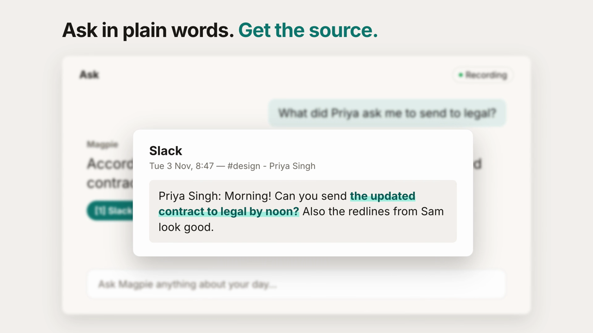

# Magpie — a private, local-first memory assistant for your Mac

[](docs/magpie-demo.mp4)

▶ **[Watch the 38-second demo](docs/magpie-demo.mp4)**

Magpie watches what's on your screen, remembers it, and lets you **search it, chat
with it, get daily journals, track open loops, and take meeting notes**, all on
your machine. Screen text is captured every few seconds, OCR'd on-device,
redacted, and stored in a plain local SQLite database.

## What you get

- **Ask in plain words, get the source.** Every answer cites the captures it came from; click a citation to see what was on screen.
- **Timeline and search** of your whole day, by app and window.
- **Daily journal and open loops.** Loose ends found on your screen become Reminders, Calendar events, Mail drafts (never sent) or Notion pages.
- **Meetings.** System audio and mic recorded via ScreenCaptureKit, transcribed locally, labelled "Me" and "Them", with notes.
- **Native Mac app** with a menu-bar menu, a global **⌥Space** quick-ask panel and notifications.
- **Phone access** as a private web app over your Wi-Fi or Tailscale, paired with a six-digit code.
- **Any model:** local Ollama by default, or any OpenAI-compatible API, or Anthropic.
- **MCP server included**, so Claude Desktop or opencode can use your memory.
- **Secret redaction** (cards, API keys, tokens, JWTs, SSNs, passwords), excluded apps, retention controls and full JSON export.

## Install

Requires macOS on Apple Silicon and [uv](https://docs.astral.sh/uv/).

```bash
cd /path/to/magpie
uv venv --python 3.14 .venv
uv pip install --python .venv/bin/python -e .
```

Build the Swift helper (OCR + window tracking + permissions):

```bash
swift build -c release --package-path helper
```

Grant **Screen Recording** so Magpie can read your screen:
open `System Settings → Privacy & Security → Screen Recording`, enable it for
the app you launched Magpie from (Terminal, iTerm2, or Magpie itself), then
quit and relaunch that app — macOS requires a restart after granting.

## Run

```bash
.venv/bin/magpie serve
```

Then open **http://127.0.0.1:7777** in your browser. Capture starts
automatically every 15 seconds while you use your Mac (pauses when you're idle).

Check that everything is wired up:

```bash
.venv/bin/magpie doctor
```

`magpie doctor` verifies the helper is built, Screen Recording is granted, the
LLM provider is reachable, and `ffmpeg`/`mlx_whisper` are available for
meetings — and prints how to fix anything that isn't.

## Recommended local model

The default model is small but weak. For good Ask/Journal/Loops quality, pull
`qwen3:8b` (≈5 GB, runs fine on 16 GB machines):

```bash
ollama pull qwen3:8b
```

**Switching providers:** open
**Settings → Model provider** in the web UI (or edit `~/.magpie/config.json`).
Options: `ollama` (default — Base URL `http://localhost:11434`), `openai` (or
any OpenAI-compatible endpoint via Base URL + API key), or `anthropic`. The API
key is stored locally and never sent back to the UI in plain form. All models still
answer only from your local screen memory.

## Use Magpie from Claude Desktop or opencode (MCP)

Magpie ships a free MCP server so any MCP client can search your memory:

```bash
.venv/bin/magpie mcp
```

Tools: `search_memory`, `get_timeline`, `get_journal`, `list_open_loops`,
`ask_memory`, `create_reminder`, `create_calendar_event`, `draft_email`,
`get_calendar`.

**Claude Desktop** — edit `~/Library/Application Support/Claude/claude_desktop_config.json`:

```json
{
  "mcpServers": {
    "magpie": {
      "command": "/path/to/magpie/.venv/bin/magpie",
      "args": ["mcp"]
    }
  }
}
```

**opencode** — add to `opencode.json`:

```json
{
  "mcp": {
    "magpie": {
      "type": "local",
      "command": ["/path/to/magpie/.venv/bin/magpie", "mcp"]
    }
  }
}
```

## Privacy model

- **Everything lives in `~/.magpie/` on this Mac only**: `magpie.db` (SQLite),
  `shots/YYYY-MM-DD/*.jpg`, extracted text. The server binds to `127.0.0.1`.
- **Secrets are redacted before storage**: credit cards (Luhn-validated), AWS /
  OpenAI / Anthropic / GitHub / Slack keys, JWTs, private key blocks, SSNs, and
  `password: …` lines are replaced with `[REDACTED:<kind>]`.
- **You control capture**: excluded apps list, private-browsing detection,
  pause/resume (header button or ⌘/click), idle auto-pause, configurable
  interval, optional screenshot keeping.
- **Retention & erasure**: default 30 days, adjustable; delete last hour /
  today / any date range; export everything as JSON.
- **Cloud only if you choose it**: with the default local Ollama provider,
  nothing about your content leaves your Mac. If you pick OpenAI/Anthropic,
  only the redacted model context is sent to that provider — your database and
  screenshots never move.
- **Meetings**: transcribed locally with `mlx_whisper`. Phone/PWA access over
  LAN or Tailscale is opt-in and requires a pairing code + bearer token.

## Limitations

- macOS and Apple Silicon only (Swift helper uses Vision, ScreenCaptureKit, EventKit).
- OCR is English-optimized and screenshots only the main display.
- Screen memory is what appeared on screen — it can't see audio you didn't record,
  encrypted databases, or private/incognito windows (by design).
- Meeting system audio requires the ScreenCaptureKit helper path; on older setups
  or if the helper fails, recording falls back to **mic only** (full system audio
  normally needs a loopback device like BlackHole — Magpie avoids it).
- Meeting transcripts are as good as on-device speech-to-text; noisy calls will
  produce imperfect notes.
- Assistant answers come only from what was captured — gaps in capture are gaps
  in memory. Very small local models (e.g. 1B) produce weaker answers.

## Development

```bash
.venv/bin/pytest          # tests, no network, no real screen
```

See `SPEC.md` for the full design document.
